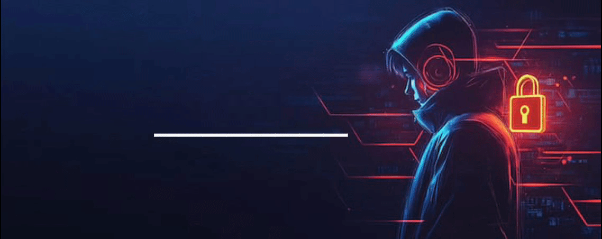

 <!-- VAMSHI G A | CYBERSECURITY & AI/ML PROFILE -->

  

<h1 align="center">VAMSHI G A</h1>

<h3 align="center">CYBERSECURITY | AI/ML | SECURITY ENGINEERING | RESEARCH</h3>

  

  
  

---

## ABOUT

Cybersecurity and AI/ML enthusiast focused on understanding, analyzing, and securing modern digital infrastructure.

My technical interests span offensive security, defensive security, application security, cloud infrastructure, machine learning, and intelligent threat detection.

I focus on developing practical technical knowledge across the cybersecurity lifecycle — from vulnerability discovery and exploitation analysis to threat detection, incident response, and security engineering.

**Core Interests**
- Offensive Security & Red Team Operations
- Defensive Security & Security Operations
- Vulnerability Research & Exploit Analysis
- Application & API Security
- Cloud Security & DevSecOps
- Digital Forensics & Incident Response
- Artificial Intelligence & Machine Learning
- AI Security & Adversarial Machine Learning
- Threat Intelligence & Detection Engineering

---

# CYBERSECURITY TECHNOLOGY STACK

## 01. FOUNDATION — SECURITY FUNDAMENTALS

<b>Networking, Operating Systems & Security Fundamentals</b>

 

**Security Fundamentals**

**Networking**

- TCP/IP, UDP, ICMP
- OSI Model
- DNS, DHCP, ARP
- HTTP / HTTPS
- TLS / SSL
- Subnetting and Routing
- Network Segmentation
- Ports and Protocols

**Operating Systems**

- Linux Administration
- Windows Security
- File Permissions
- User and Group Management
- System Hardening
- Patch Management
- Backup and Recovery
- Log Management

**Network Analysis**

- Wireshark
- Nmap
- Network Troubleshooting
- Packet Analysis
- Network Discovery

## 02. INTERMEDIATE — SECURITY OPERATIONS & ETHICAL HACKING

<b>Red Team, Blue Team, SOC & Application Security</b>

 

**🔴 Offensive Security & Penetration Testing**

- Vulnerability Assessment
- Penetration Testing Methodologies
- Reconnaissance & Enumeration
- Web Application Penetration Testing
- API Security Testing
- Authentication & Authorization Testing
- Privilege Escalation
- Password Security Testing
- Network Penetration Testing
- OWASP Top 10
- OWASP API Security Top 10

**🔵 Blue Team & SOC Operations**

- Security Operations Center (SOC)
- SIEM Monitoring & Log Analysis
- Security Event Correlation
- Threat Hunting
- Incident Response
- Endpoint Detection & Response (EDR)
- Intrusion Detection & Prevention (IDS/IPS)
- Security Alert Investigation
- Threat Intelligence
- Detection Engineering
- MITRE ATT&CK Framework

**Network Intrusion Detection**

- Snort
- Suricata
- Zeek
- Network Traffic Analysis
- Signature-Based Detection
- Anomaly-Based Detection

**Digital Forensics**

- Digital Evidence Collection
- File System Forensics
- Memory Forensics Fundamentals
- Disk Forensics
- Incident Investigation
- Timeline Analysis

**Active Directory Security**

- Active Directory Fundamentals
- Windows Domain Security
- Kerberos Authentication
- Group Policy Security
- Identity and Access Management
- Directory Enumeration

**Vulnerability Management**

- Nessus
- Vulnerability Scanning
- CVE / CVSS
- Vulnerability Prioritization
- Security Assessment Reporting
- Remediation Validation

## 03. ADVANCED — SECURITY ENGINEERING & RESEARCH

<b>Advanced Offensive Security, Defensive Security & Research</b>

 

**🔴 Advanced Red Team & Adversary Simulation**

- Advanced Penetration Testing
- Red Team Operations
- Purple Team Exercises
- Active Directory Attack Paths
- Privilege Escalation
- Exploit Development
- Binary Exploitation
- Buffer Overflow Analysis
- Reverse Engineering
- Malware Analysis
- Command and Control Concepts
- Adversary Emulation
- Post-Exploitation Analysis
- Evasion Techniques and Detection Research

**Advanced Tools**

**🔵 Advanced Blue Team & Threat Intelligence**

- Advanced Threat Hunting
- Threat Intelligence Platforms
- MITRE ATT&CK Mapping
- Detection Engineering
- Sigma Detection Rules
- YARA Rules
- Security Orchestration, Automation and Response (SOAR)
- Endpoint Detection & Response (EDR)
- Extended Detection & Response (XDR)
- Malware Reverse Engineering
- Advanced Incident Response
- Digital Forensics & Incident Response (DFIR)
- Threat Actor Analysis
- Security Telemetry & Log Correlation

**Security Platforms**

**☁️ Cloud Security & Infrastructure Protection**

- AWS Security Architecture
- Microsoft Azure Security
- Google Cloud Security
- Cloud Identity & Access Management
- Cloud Network Security
- Cloud Workload Protection
- Cloud Security Posture Management (CSPM)
- Cloud Logging & Monitoring
- Zero Trust Architecture
- Infrastructure Hardening
- Secrets Management
- Cloud Incident Response

**Cloud Security Technologies**

- AWS IAM
- AWS CloudTrail
- AWS GuardDuty
- AWS Security Hub
- Microsoft Defender for Cloud
- Azure Entra ID
- Google Cloud Security Command Center
- Wiz

**⚙️ DevSecOps & Container Security**

- DevSecOps Architecture
- CI/CD Pipeline Security
- Infrastructure as Code Security
- Docker Security
- Kubernetes Security
- Container Image Scanning
- Software Supply Chain Security
- SAST / DAST / SCA
- Secrets Detection
- Dependency Vulnerability Management
- Runtime Security
- Policy as Code

**Security Tools**

- Trivy
- Checkov
- Semgrep
- SonarQube
- OWASP ZAP
- GitHub Advanced Security
- Falco
- HashiCorp Vault
- Open Policy Agent (OPA)

**🔐 Advanced Identity & Security Architecture**

- Zero Trust Security
- Identity and Access Management (IAM)
- Privileged Access Management (PAM)
- Multi-Factor Authentication
- Role-Based Access Control
- Attribute-Based Access Control
- Privilege Management
- Identity Governance
- Secure Authentication Architecture

## 04. AI / ML & ARTIFICIAL INTELLIGENCE SECURITY

<b>Machine Learning, Deep Learning, AI Security & Intelligent Threat Detection</b>

 

**Artificial Intelligence & Machine Learning**

- Supervised & Unsupervised Learning
- Classification & Regression
- Clustering Algorithms
- Anomaly Detection
- Feature Engineering
- Model Evaluation & Optimization
- Deep Learning
- Neural Networks
- Natural Language Processing
- Computer Vision
- Time-Series Analysis
- Data Analytics
- Predictive Modelling

**AI-Powered Cybersecurity**

- Machine Learning-Based Intrusion Detection
- Network Traffic Classification
- Anomaly-Based Threat Detection
- Malware Classification
- Phishing Detection
- Fraud Detection
- Automated Threat Intelligence
- Intelligent Security Analytics
- AI-Assisted Security Operations

**Advanced AI Security**

- Adversarial Machine Learning
- Adversarial Examples
- Model Evasion & Poisoning
- Model Security & Robustness
- LLM Security
- Prompt Injection
- Retrieval-Augmented Generation (RAG) Security
- AI Red Teaming
- AI Governance & Risk Management
- MITRE ATLAS
- OWASP Top 10 for LLM Applications

**AI Security Research Tools & Frameworks**

- PyTorch
- TensorFlow
- Scikit-learn
- Hugging Face
- MLflow
- MITRE ATLAS
- OWASP LLM Top 10

## 05. ADVANCED RESEARCH & EMERGING TECHNOLOGIES

<b>Emerging Security Technologies</b>

 

- Post-Quantum Cryptography
- Cryptographic Engineering
- Hardware Security Fundamentals
- Secure Systems Architecture
- Privacy Engineering
- Blockchain Security
- Smart Contract Security
- IoT Security
- Embedded Systems Security
- Firmware Analysis
- Threat Modelling
- Security Architecture
- Supply Chain Security
- Vulnerability Research
- Responsible Vulnerability Disclosure
- Security Automation
- AI Safety & Security

**Standards & Frameworks**

- NIST Cybersecurity Framework
- NIST SP 800 Series
- ISO/IEC 27001
- CIS Critical Security Controls
- MITRE ATT&CK
- MITRE D3FEND
- MITRE ATLAS
- OWASP Application Security Verification Standard
- OWASP Top 10
- CVE / CVSS

---

# PROGRAMMING & SOFTWARE ENGINEERING

**Languages**

**Frontend & Backend**

**Databases**

**Development & Infrastructure**

---

# SECURITY LEARNING & RESEARCH PLATFORMS

---

# CONNECT WITH ME

&nbsp;&nbsp;&nbsp;

&nbsp;&nbsp;&nbsp;

&nbsp;&nbsp;&nbsp;

<a href="https://www.linkedin.com/in/vamshiga">LinkedIn</a> |
<a href="https://github.com/vamshi7879">GitHub</a> |
<a href="https://www.youtube.com/@vamshi-indus">YouTube</a> |
<a href="mailto:vamshiga06@gmail.com">Email</a>

---

# GITHUB STATISTICS

# GITHUB TROPHIES

# CONTRIBUTION ACTIVITY

---

<b>THINK LIKE AN ATTACKER. ENGINEER LIKE A DEFENDER.</b>
 
<i>Building intelligent security for an evolving digital world.</i>

<!-- END OF PROFILE README -->
